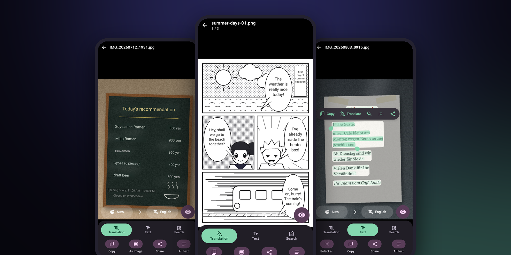
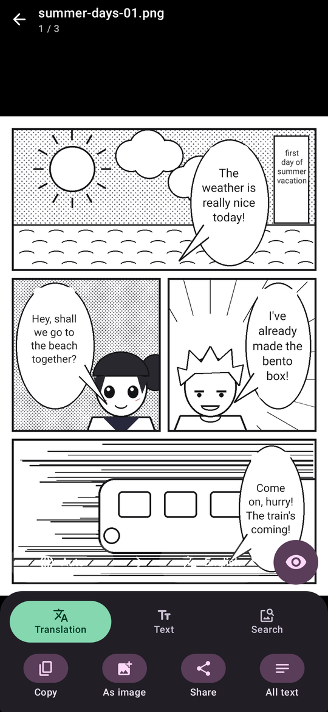
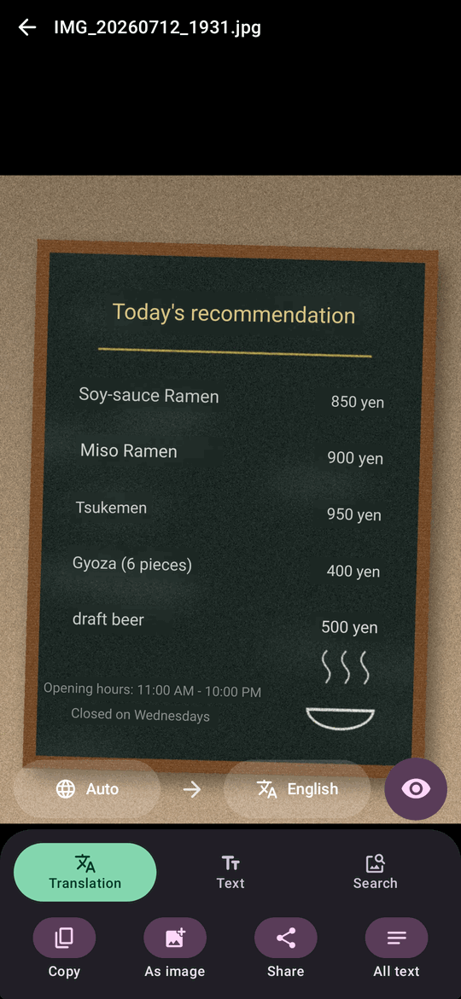
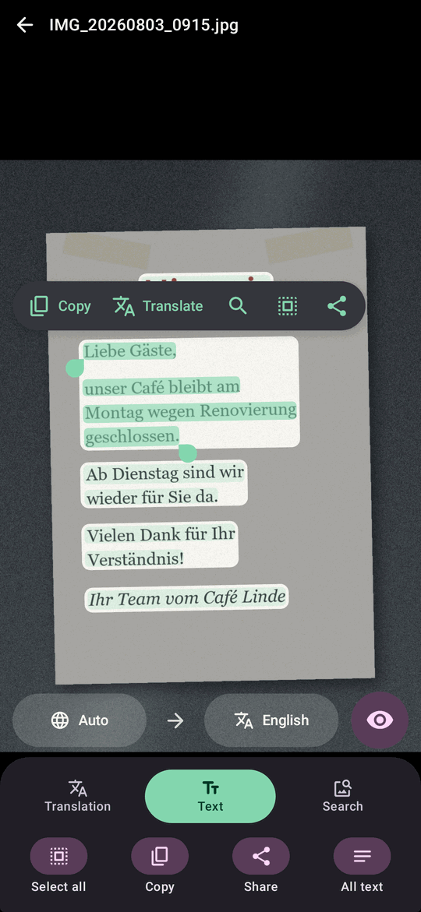
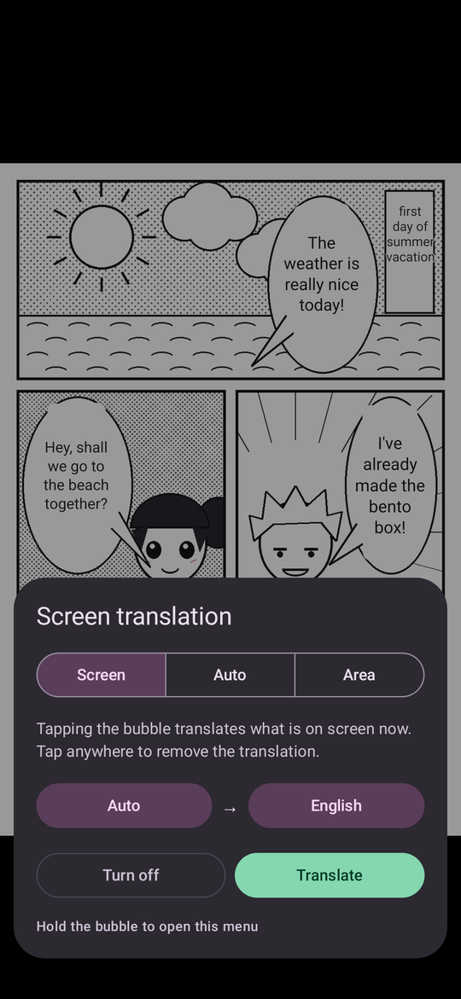
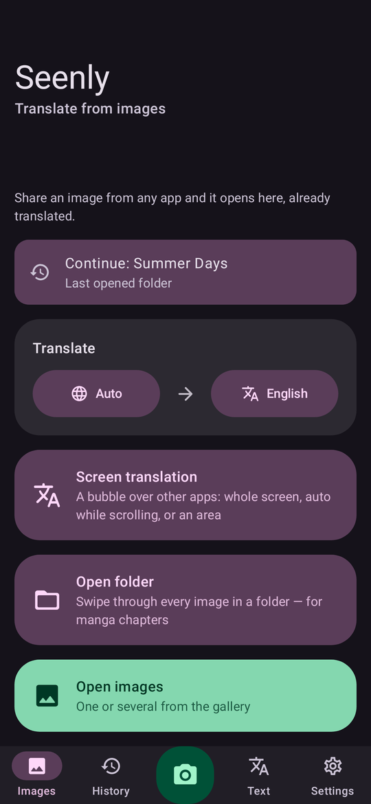
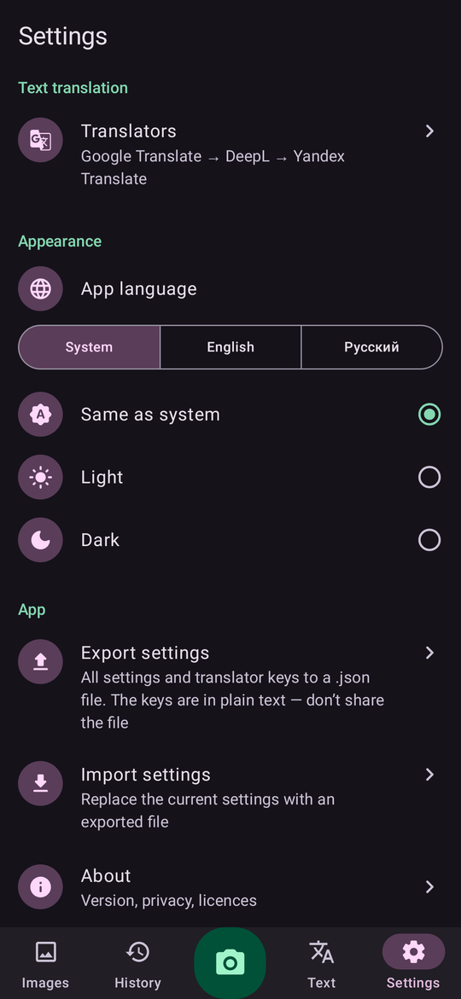
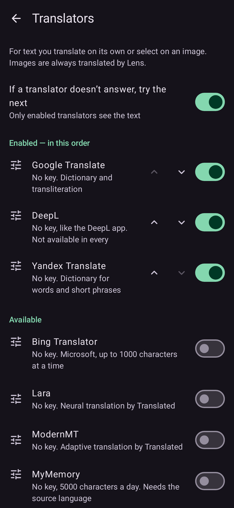

# Seenly

<p align="center">
  <strong>English</strong> | <a href="README_ru.md">Русский</a>
</p>

<p align="center">
  
</p>

Translate the text in any picture, in place: screenshots, photos, manga chapters, or whatever is on your screen right now.

Seenly is an Android app (with a desktop build) written with Kotlin Multiplatform and Compose Multiplatform. It reads text through the same Lens service that Chrome's built-in Lens overlay uses. It draws the translation over the original and erases what was there.

> Seenly is an independent project. It is not affiliated with, endorsed or supported by Google LLC. Google, Google Lens and Google Translate are trademarks of Google LLC, named here only to say which services the app talks to.

## What it does

- **Translate an image.** Share a picture into the app, open several from the gallery, or open a whole folder and swipe through it (made for manga chapters). The translation is drawn in place: line by line for signs and screenshots, re-flowed into the bubble for manga.
- **Translate the screen.** A floating bubble works over any app:
  - **This screen**: translates what is visible now.
  - **Auto**: translates by itself every time the picture stops moving.
  - **Area**: translates only inside a frame you place.

  With the optional accessibility service the translation is fully opaque and needs no screen-recording consent; the service reads no events and no window content.
- **Select and copy text** on the image, copy the original or the translation, export the translated picture.
- **Visual search**: circle something, or tap a dot Lens found, to search for it.
- **Text translators** for typed and selected text: Google, Bing, Yandex, DeepL, LibreTranslate, OpenAI-compatible and more, in your order, with fail-over.
- **Works offline** (the `google` build): recognition and translation on the device with Google ML Kit, as a fallback when Lens is unreachable or as the only mode.
- **Google account (experimental)**: sign in, or import browser cookies. Lens currently refuses cookie-signed requests from anything but Chrome, so requests stay anonymous; the option is kept for if that changes. The cookies stay encrypted on the device and go only to Google.
- **Updates itself**: checks GitHub for a new release, verifies the download and shows what is new.
- History, Material 3 Expressive design, light and dark themes, settings export and import.

## Which APK

Each [release](https://github.com/bropines/seenly/releases) has two APKs. They are different apps to Android and can be installed side by side.

- `Seenly-v…-google-release.apk`: everything, including on-device recognition and translation through Google ML Kit. ML Kit is closed-source and needs Google Play services on the phone. Pick this one unless you have a reason not to. It is the larger file (ML Kit's translator) and is built for ARM phones only.
- `Seenly-v…-foss-release.apk`: open-source code only, with no ML Kit and no Play services; it works on a phone without Google's apps. Everything goes through Lens and the online translators, so there is no offline mode.

Both update themselves from GitHub releases, each with its own file, checked against the release's `SHA256SUMS`.

## Screenshots

<table>
  <tr>
    <td width="25%" align="center"><br/><sub>A manga page: each bubble re-flowed in English</sub></td>
    <td width="25%" align="center"><br/><sub>A photo of a menu, translated line by line in place</sub></td>
    <td width="25%" align="center"><br/><sub>Select the original text and copy, translate or search it</sub></td>
    <td width="25%" align="center"><br/><sub>The bubble's menu, over a page it has just translated</sub></td>
  </tr>
  <tr>
    <td width="25%" align="center"><br/><sub>Home: open images or a folder, or start the bubble</sub></td>
    <td width="25%" align="center"><br/><sub>Settings, with the app's own language</sub></td>
    <td width="25%" align="center"><br/><sub>Text translators, in your order, with fail-over</sub></td>
    <td width="25%"></td>
  </tr>
</table>

The screenshots are rendered on the build machine from made-up pictures (`scripts/demo_images.py`): `./gradlew readmeShots`, then `python3 scripts/readme_shots.py`.

## Modules

| Module | What it is |
|---|---|
| `lens-protocol` | Kotlin Multiplatform client for the Lens protocol: OCR, translation, background patches, visual search, tall-image tiling |
| `lens-overlay` | Renders a translated scan over the image (Compose), with text selection and zoom |
| `translators` | Pluggable text translation engines with a fail-over pipeline |
| `lens-cli` | Command-line client: `lens <image> -t en [--tiled] [--json]` |
| `app/shared`, `app/android`, `app/desktop` | The Seenly app |

## Building

You need JDK 21 and the Android SDK (compile SDK 37.1).

```bash
./gradlew :app:android:assembleGoogleDebug   # debug build, signed with the public dev key
./gradlew :app:android:assembleGoogleRelease # minified release
./gradlew :app:desktop:run                   # desktop app
./gradlew :lens-cli:installDist              # the CLI
```

The app comes in two flavors (see [Which APK](#which-apk)):
- `google`: adds on-device recognition and translation with Google ML Kit (`app/android/src/google`), which needs Google Play services;
- `foss`: nothing proprietary on the device. `scripts/check-foss-apk.sh` checks a built APK for stray ML Kit, Play services or Firebase code.

A release build is signed with the key described by these entries, read from `~/.gradle/gradle.properties` or the environment:

```
lens.release.storeFile=/path/to/key.jks
lens.release.storePassword=…
lens.release.keyAlias=…
lens.release.keyPassword=…
```

Without them, the release is signed with the public dev key in `app/android/dev.keystore`. That key is fine for testing and must never be used for a published release.

## Status

Early, but in daily use. Expect changes.

## License

GPL-3.0. See [LICENSE](LICENSE).
