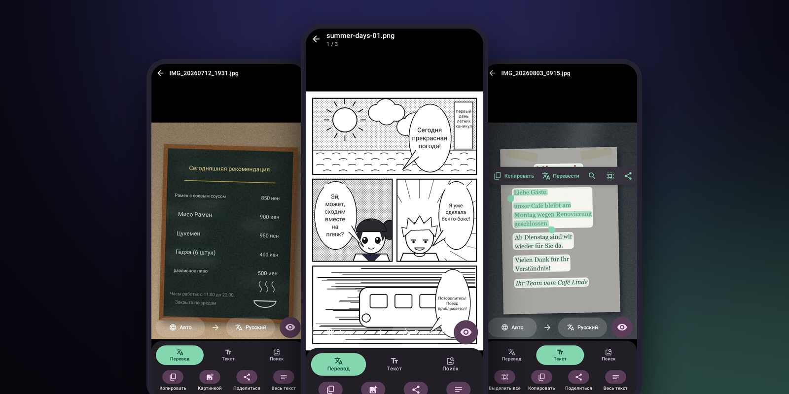
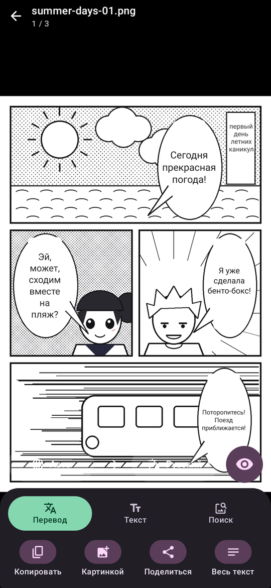
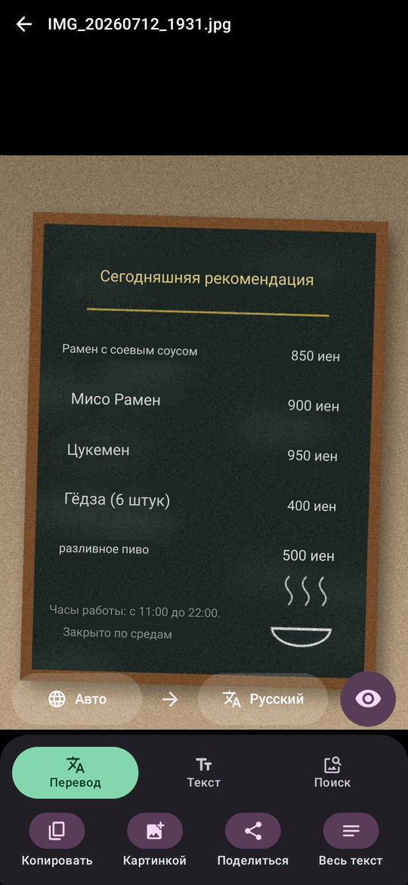
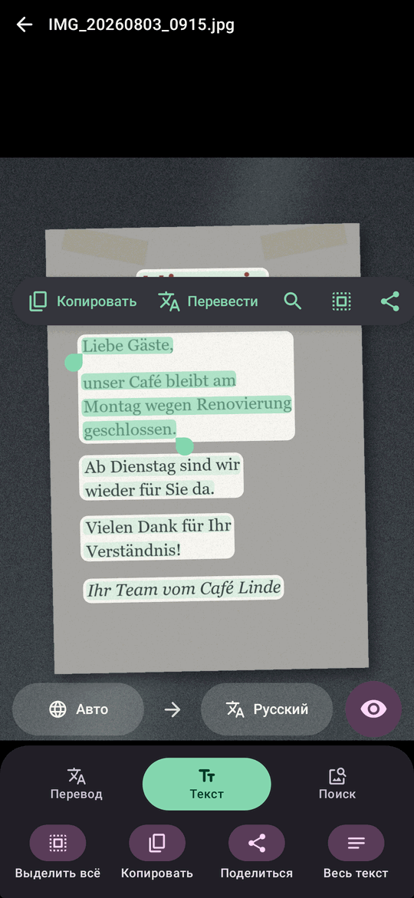
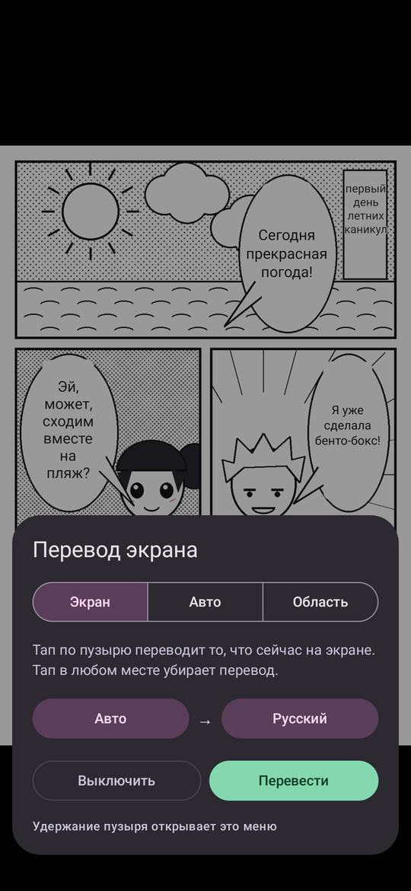
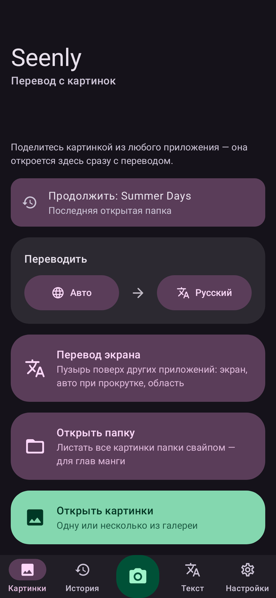
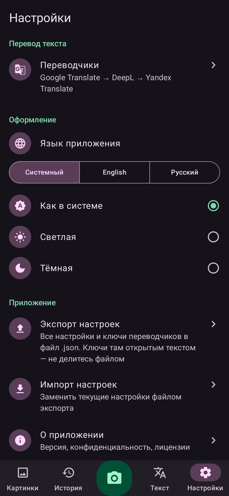
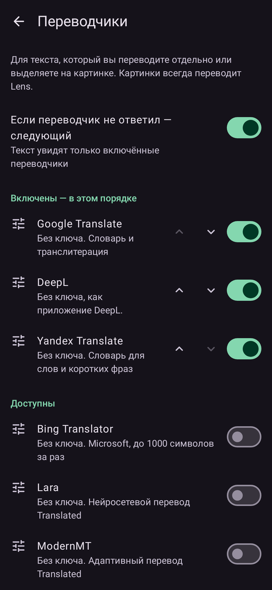

# Seenly

<p align="center">
  <a href="README.md">English</a> | <strong>Русский</strong>
</p>

<p align="center">
  
</p>

Переводит текст на любой картинке прямо на месте: скриншоты, фотографии, главы манги или то, что сейчас на экране.

Seenly — приложение для Android (есть и сборка для компьютера), написанное на Kotlin Multiplatform и Compose Multiplatform. Текст оно читает через тот же сервис Lens, что и встроенный в Chrome оверлей Lens. Перевод рисуется поверх оригинала, а исходный текст стирается.

> Seenly — независимый проект. Он не связан с Google LLC, не одобрен и не поддерживается ею. Google, Google Lens и Google Translate — товарные знаки Google LLC; они названы здесь только для того, чтобы сказать, с какими сервисами работает приложение.

## Что оно умеет

- **Переводить картинки.** Поделитесь картинкой с приложением, откройте несколько из галереи или целую папку и листайте её (это сделано для глав манги). Перевод рисуется на месте: построчно для вывесок и скриншотов, а в манге текст заново укладывается в пузырь.
- **Переводить экран.** Плавающий пузырь работает поверх любого приложения:
  - **Экран**: переводит то, что видно сейчас.
  - **Авто**: переводит сам каждый раз, когда картинка перестаёт двигаться.
  - **Область**: переводит только внутри рамки, которую вы поставили.

  С необязательной службой специальных возможностей перевод полностью непрозрачный и не требует согласия на запись экрана; служба не читает ни события, ни содержимое окон.
- **Выделять и копировать текст** на картинке, копировать оригинал или перевод, сохранять переведённую картинку.
- **Визуальный поиск**: обведите что-нибудь или нажмите на точку, которую нашёл Lens, чтобы найти это.
- **Переводчики текста** для набранного и выделенного текста: Google, Bing, Яндекс, DeepL, LibreTranslate, OpenAI-совместимые и другие, в вашем порядке, с переключением на следующий при сбое.
- **Работать без сети** (сборка `google`): распознавание и перевод на устройстве через Google ML Kit, как подстраховка, когда Lens недоступен, или как единственный режим.
- **Аккаунт Google (экспериментально)**: войдите или импортируйте cookies из браузера. Сейчас Lens отклоняет запросы с cookies от всех, кроме Chrome, поэтому запросы остаются анонимными; настройка оставлена на случай, если это изменится. Cookies хранятся на устройстве в зашифрованном виде и отправляются только в Google.
- **Обновляться самому**: приложение спрашивает у GitHub о новых выпусках, проверяет скачанный файл и показывает, что изменилось.
- История, дизайн Material 3 Expressive, светлая и тёмная темы, экспорт и импорт настроек.

## Какой APK выбрать

В каждом [выпуске](https://github.com/bropines/seenly/releases) две сборки, `google` и `foss`. Для Android это разные приложения, их можно поставить рядом.

Каждая сборка выходит отдельным APK под каждый тип процессора и универсальным. Почти всем телефонам нужен `arm64-v8a`, старым 32-битным — `armeabi-v7a`, эмуляторам и Chromebook — `x86_64` или `x86`. `universal` работает везде и весит больше всех. Тип указан в имени: `Seenly-v…-google-arm64-v8a-release.apk`.

- `google`: всё, включая распознавание и перевод на устройстве через Google ML Kit. ML Kit — закрытый код, ему нужны сервисы Google Play на телефоне. Берите этот, если нет причин поступить иначе. Этот файл больше из-за переводчика ML Kit.
- `foss`: только открытый код, без ML Kit и сервисов Play; работает на телефоне без приложений Google. Всё идёт через Lens и онлайн-переводчики, поэтому режима без сети нет.

Оба обновляются сами из выпусков на GitHub: скачивают APK под процессор телефона и сверяют его с `SHA256SUMS` выпуска.

## Скриншоты

<table>
  <tr>
    <td width="25%" align="center"><br/><sub>Страница манги: каждый пузырь заново уложен по-русски</sub></td>
    <td width="25%" align="center"><br/><sub>Фото меню, переведённое построчно на месте</sub></td>
    <td width="25%" align="center"><br/><sub>Выделите исходный текст, чтобы скопировать, перевести или найти его</sub></td>
    <td width="25%" align="center"><br/><sub>Меню пузыря поверх только что переведённой страницы</sub></td>
  </tr>
  <tr>
    <td width="25%" align="center"><br/><sub>Главный экран: открыть картинки или папку, включить пузырь</sub></td>
    <td width="25%" align="center"><br/><sub>Настройки, в том числе язык приложения</sub></td>
    <td width="25%" align="center"><br/><sub>Переводчики текста в вашем порядке, с переключением при сбое</sub></td>
    <td width="25%"></td>
  </tr>
</table>

Скриншоты отрисованы на машине сборки из придуманных картинок (`scripts/demo_images.py`): `./gradlew readmeShots`, затем `python3 scripts/readme_shots.py`.

## Модули

| Модуль | Что это |
|---|---|
| `lens-protocol` | Клиент протокола Lens на Kotlin Multiplatform: распознавание, перевод, фоновые заплатки, визуальный поиск, нарезка высоких картинок |
| `lens-overlay` | Рисует переведённый скан поверх картинки (Compose), с выделением текста и масштабированием |
| `translators` | Подключаемые движки перевода текста с цепочкой переключения при сбое |
| `lens-cli` | Клиент для командной строки: `lens <image> -t en [--tiled] [--json]` |
| `app/shared`, `app/android`, `app/desktop` | Приложение Seenly |

## Сборка

Нужны JDK 21 и Android SDK (compile SDK 37.1).

```bash
./gradlew :app:android:assembleGoogleDebug   # отладочная сборка, подписана публичным dev-ключом
./gradlew :app:android:assembleGoogleRelease # минифицированный релиз
./gradlew :app:desktop:run                   # приложение для компьютера
./gradlew :lens-cli:installDist              # CLI
```

У приложения два варианта (flavor), см. [Какой APK выбрать](#какой-apk-выбрать):
- `google`: добавляет распознавание и перевод на устройстве через Google ML Kit (`app/android/src/google`), которому нужны сервисы Google Play;
- `foss`: ничего проприетарного на устройстве. `scripts/check-foss-apk.sh` проверяет собранный APK на случайно попавший код ML Kit, сервисов Play или Firebase.

Релизная сборка подписывается ключом, который описывают эти записи в `~/.gradle/gradle.properties` или переменные окружения:

```
lens.release.storeFile=/path/to/key.jks
lens.release.storePassword=…
lens.release.keyAlias=…
lens.release.keyPassword=…
```

Без них релиз подписывается публичным dev-ключом из `app/android/dev.keystore`. Для проверки этот ключ подходит, но для опубликованного релиза его использовать нельзя.

## Состояние

Ранняя версия, но уже в ежедневном использовании. Возможны изменения.

## Лицензия

GPL-3.0, см. [LICENSE](LICENSE).
