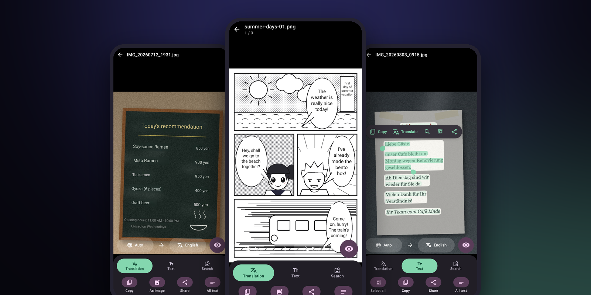
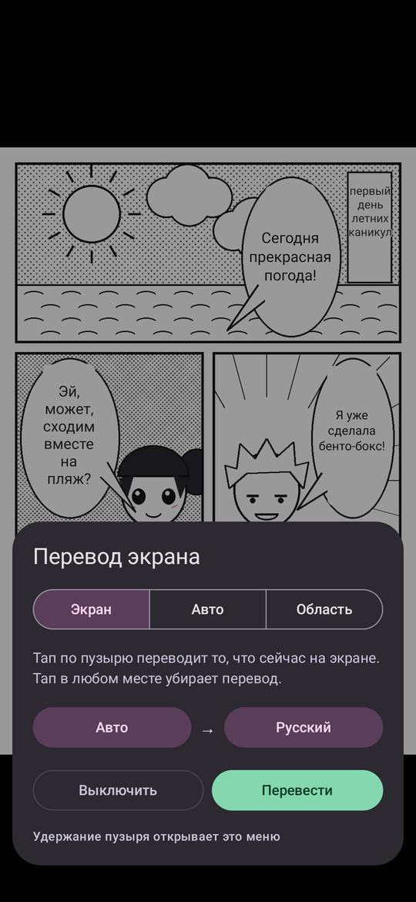

## ✨ Highlights

The first release of Seenly: translate the text in any picture, in place — screenshots, photos, manga chapters, or whatever is on your screen right now.

### 📖 Manga and long pages

Each bubble is re-flowed and shaped to the bubble, with a readable font floor. Tall pages are scanned in full-resolution bands cut between panels, so nothing is torn in half.

### 📱 The screen, over any app

A floating bubble translates the screen once, by itself whenever the picture stops moving, or inside a frame you place. With the optional accessibility service the translation is fully opaque and needs no screen-recording consent.

### Which APK

Both are signed with the same key and are the same app today. `google` is the one to take; `foss` has its own package name and installs beside it, and will stay free of Google Play services once the `google` build starts using them.

<b>🇷🇺 Что нового</b>

 

Первый релиз Seenly: перевод текста на любой картинке прямо на месте — скриншоты, фото, главы манги или то, что сейчас на экране.

### 📖 Манга и длинные страницы

Текст в пузыре перекладывается по его форме, шрифт не мельчит ниже читаемого. Длинные страницы сканируются полосами в полном разрешении, разрезанными между панелями, так что ничего не рвётся пополам.

### 📱 Экран, поверх любого приложения

Плавающая кнопка переводит экран один раз, сама — каждый раз, когда картинка перестаёт двигаться, или внутри рамки. Со службой спецвозможностей перевод полностью непрозрачный и не требует согласия на запись экрана.

### Какой APK

Оба подписаны одним ключом и сейчас это одно и то же приложение. Берите `google`; у `foss` своё имя пакета, он ставится рядом и останется без сервисов Google Play, когда `google`-сборка начнёт их использовать.

